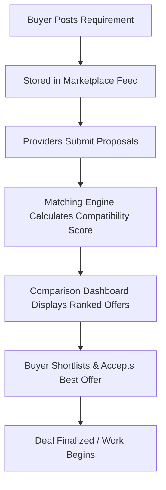

# XMARKET

A needs-first reverse marketplace where buyers post custom requirements (budget, deadline, specs) and providers submit competitive offers evaluated by an intelligent compatibility-matching engine.

[](https://opensource.org/licenses/MIT)
[](http://makeapullrequest.com)
[](https://nextjs.org)
[](https://tailwindcss.com)

> **Flip the traditional marketplace dynamic.** Instead of searching through endless listings, buyers post exact requirements, and qualified providers submit tailored offers ranked by an intelligent compatibility algorithm.

---

## 🖥️ Run the interface

```bash
npm install
cp .env.example .env.local   # optional: add one LLM key (see below)
npm run dev                  # http://localhost:3000
npm run build && npm start   # production build
```

The AI and sign-in (OAuth2) half of the app runs on a separate **FastAPI**
service (in `backend/`). It is optional to boot — if it is not running, every
AI route transparently falls back to the built-in Next.js implementation, so
the interface above works on its own. To run it:

```bash
npm run py:install   # once: create backend/.venv and install backend/requirements.txt
npm run py:dev       # http://127.0.0.1:8000  (the Next app proxies /fastapi/* to it)
```

See [FastAPI service (AI + OAuth2)](#fastapi-service-ai--oauth2) for the full
picture: what it owns, the OAuth2 endpoints, and Google sign-in.

The app ships with a seeded demo dataset (8 requirements, 17 offers, 8 providers). Everything the UI does now goes through the REST API in `app/api` and is persisted to `data/xmarket.json`, so posting a requirement, submitting a bid, shortlisting or awarding survives a reload **and** a server restart. Use the **role switch** in the header to move between the buyer and provider experiences.

```bash
npm run api:smoke    # 40 checks against a running server: CRUD, rules, ranking, import, errors
npm run ai:check     # probes the provider, then reports which engine answered each capability
npm run data:import  # pull real public tenders in (see "Real data" below)
```

<details>
<summary><b>⚠️ A page loads but buttons do nothing / login just re-renders?</b></summary>

That is a stale or half-written `.next` build — the HTML is served, but one or
more of the JavaScript chunks it needs are missing, so the page never becomes
interactive. It happens when a build and a dev server run at the same time, a
build is interrupted, or code is updated over an old build.

```bash
# stop the server, then:
npm run rebuild      # wipes .next and builds clean
npm start            # or: npm run dev
```

If it still misbehaves, also delete `node_modules` and `package-lock.json` and
re-run `npm install` before `npm run rebuild`.
</details>

Both expect the server on `http://127.0.0.1:3000` (`BASE_URL` overrides it). The smoke suite writes real records and **restores the seeded dataset at the end** — which also removes anything you posted or imported. Run it with `npm run api:smoke -- --keep` to leave the store untouched.

---

## 📥 Real data

The marketplace ships with demo content so a fresh clone is not empty. Real records go in two ways: post them in the app, or import published procurement notices.

```bash
npm run dev                                   # in one terminal
npm run data:import -- --dry-run              # fetch and report, write nothing
npm run data:import -- --limit=40             # import up to 40 notices
npm run data:import -- --keyword=software     # narrow the search
npm run data:import -- --source=ocds --file=feed.json
```

| Source | What it is | Key needed |
| --- | --- | --- |
| `contracts-finder` (default) | Open notices from **UK Contracts Finder**, published by UK public bodies. Every imported listing links back to the original notice. | none |
| `ocds` | Any [Open Contracting Data Standard](https://standard.open-contracting.org/) export, from a file or URL (Find a Tender, TED, national portals). | none |
| `sample` | A bundled fixture in `scripts/fixtures` used by the test suite. **Not live data** — for verifying the mapper offline. | none |

Useful flags: `--min-value=50000`, `--include-closed`, `--page-size=500`, `--api=http://host:3000`.

What the importer does, and deliberately does not do:

- **Maps, never invents.** CPV division codes and keyword hints pick a category; the buyer's organisation becomes a buyer record; the published value becomes the budget ceiling with an 85% target. A notice with no published value is **skipped**, not given a made-up budget.
- **Decodes and truncates** HTML entities and runaway descriptions so the feed stays readable.
- **De-duplicates on the source's own identifier**, so re-running an import only brings in what is new. A second run reports `imported 0`.
- **Records provenance.** Imported requirements carry a `source` block (name, link, reference, timestamp) and show it as a badge in the UI, so a listing can always be traced to where it came from.

To run on real data only, set `XMARKET_SEED=empty` and delete `data/xmarket.json` — the app then boots with an empty store, and everything in it is something you posted or imported.

## 🎨 UI/UX system

### Design language — monochrome, minimal

Procurement is a comparison task, so the interface is built around *legibility of differences*: prices, dates and scores line up, and nothing competes with them for attention. The palette is black, white and a five-step gray. There is exactly one accent — white — and it always means "this is the action" or "this is the strongest value".

| Token | Value | Used for |
| --- | --- | --- |
| `--color-ink-950 … 600` | `#000000` → `#262626` | canvas, panels, controls |
| `--color-accent-500` | `#ffffff` | primary buttons, active state, focus ring |
| `--color-score-high / mid / low` | `#ffffff` / `#a6a6a6` / `#6b6b6b` | the compatibility score ramp |

The score ramp is **intensity, not hue** — 96 renders as a bright white ring, 61 as a mid-gray one. Ranking stays readable at a glance and in print, and nothing depends on colour vision. Health states follow the same rule: strong offers get a heavier fill and a brighter border, weak ones recede.

**No gradients, no glows, no blur.** Panels are flat with a single hairline border; hover states shift the border and background one step. Motion is one 400 ms entrance and 500 ms bar transitions, collapsing under `prefers-reduced-motion`.

**Type.** Inter, with tabular numerals (`.num`) on every price, percentage, day count and score so columns align and cannot be misread.

### Composite primitives

`.surface` / `.surface-flat` panels, `.field` inputs, `.chip` tags, `.frame` page gutters, `.eyebrow` section labels. They live in `app/globals.css` so every screen stays visually consistent without class soup.

### Reusable components

`components/ui/primitives.tsx` — Button, Badge, StatusBadge, Card, Avatar, Rating, Progress, Segmented, EmptyState, TimeAgo, Divider
`components/ui/score.tsx` — ScoreRing, ScorePill, FactorBar, ScoreBreakdown, Sparkline
`components/ui/overlay.tsx` — Modal, Toaster

`Tone` (`neutral | outline | solid | muted | good | warn | bad`) maps semantic emphasis onto the monochrome scale, so *"accepted"* reads as a filled white pill and *"declined"* as a faint outline — the same distinction, without hue.

### Screens

| Route | Purpose | UX highlights |
| --- | --- | --- |
| `/` | Landing | Live re-ranking demo (change priorities, watch bids move), how-it-works, engine explainability, two-sided value props |
| `/market` | Requirement feed | Search across specs, category rail, budget bands, urgency + saved filters, four sort modes |
| `/market/[id]` | Requirement detail | Full brief, must-have checklist, scored offer list, offer inspector, bid composer with live score preview |
| `/compare` | Comparison index | All requirements that have offers, leading offer, price spread |
| `/compare/[id]` | **Comparison workspace** | 9-factor offer matrix with best-in-row emphasis, priority weighting sliders, hide/unhide offers, CSV export, print stylesheet, award flow with risk warnings |
| `/dashboard` | Buyer + provider command centre | Role-aware: budget exposure sparkline, decision queue, offer pipeline; provider view adds capability-fit scoring and win-rate coaching |
| `/post` | 3-step requirement wizard | Live preview card, provider-match preview, tag suggestions, milestone and validation feedback before publishing |
| `/proposals` | Offer ledger | Status filters, score per row, inline shortlist/accept, competition rank for providers |

### Interaction patterns

- **Explainability everywhere.** No score appears without its three factor bars and a plain-language reason.
- **Tunable priorities.** Weight sliders (budget / timeline / relevance) sit next to the ranking they control and re-sort instantly.
- **Progressive disclosure.** Feed → detail → comparison matrix → modal inspector.
- **Honest state.** Decline and award show a confirmation with the trade-offs and a watch-list of risks.
- **Empty, loading and error states are designed,** each carrying a next action.
- **Keyboard and a11y.** Skip link, focus-visible rings, ⌘K command palette, `aria-pressed` on toggles, `role="progressbar"` with values, labelled inputs, reduced-motion support.

### Server/client rendering invariants

React recoverable hydration errors come from markup that differs between the server render and the first client render. Two rules keep that from happening, and both are enforced by the code rather than by convention:

1. **No relative time during SSR.** `<TimeAgo>` renders a deterministic absolute date first and swaps to the relative label only after mount, behind `suppressHydrationWarning`.
2. **No fractional values in markup.** Day counts are rounded at the source (`Math.round(daysUntil(...))`), the engine scores against whole days, and every number reaching an inline style or SVG attribute goes through `round()` in `lib/format.ts`.

## 📌 Problem Statement

Traditional online marketplaces force users to browse through hundreds of irrelevant listings to find products or services matching their needs. This process is time-consuming, inefficient, and often fails when buyers have strict budgets, tight deadlines, or unique specifications.

## 💡 Solution

**XMARKET** is a reverse-bidding and procurement ecosystem designed to put the buyer's needs first:

1. **Buyers** post detailed requirements (specifications, category, max budget, deadline).
2. **Providers** submit targeted bids and proposals.
3. **The Matching Engine** scores each proposal based on compatibility (budget alignment, delivery speed, and relevance).
4. **The Comparison Dashboard** allows buyers to easily compare, shortlist, and accept the best offer.

---

## 🚀 Key Features

### 👤 For Buyers

- **Requirement Posting:** Create detailed requests with categories, budget caps, delivery deadlines, and custom tags.
- **Comparison Dashboard:** Side-by-side evaluation of all incoming bids.
- **Offer Management:** Shortlist promising offers, reject outliers, and finalize deals.
- **Smart Filtering:** Sort bids by compatibility score, lowest price, or fastest delivery.

### 🏢 For Providers / Sellers

- **Opportunity Feed:** Browse and search buyer requests relevant to your domain/skills.
- **Custom Bid Submission:** Propose pricing, estimated delivery date, and a customized pitch/milestones — with a live score preview before submitting.
- **Status Tracking:** Track whether bids are pending, shortlisted, accepted, or rejected.

### 🧠 Smart Compatibility Engine

Every offer is automatically evaluated using a multi-factor scoring algorithm (`lib/engine.ts`):

- **Budget Compatibility:** Rewards offers at or under the buyer's target price, decays gently up to the hard ceiling, and penalises over-ceiling bids hard. Suspiciously cheap bids take a credibility penalty.
- **Timeline Match:** Compares promised delivery days against the buyer's deadline, with a bonus for realistic buffer.
- **Requirement Relevance:** Weighted blend of spec-tag coverage, category fit, rating, on-time rate, response speed and verification.

$$\text{Compatibility Score} = w_1(\text{Budget}) + w_2(\text{Timeline}) + w_3(\text{Relevance})$$

Default weights are `0.35 / 0.30 / 0.35` and are tunable per requirement from the UI.

---

## 🛠️ Tech Stack

- **Frontend:** Next.js (App Router) / React 19 / TypeScript / Tailwind CSS v4 / Lucide Icons
- **Backend:** Next.js route handlers (`app/api`) on the Node runtime, zod-validated input, envelope responses
- **Persistence:** single JSON document behind a serialised write queue (`lib/server/db.ts`), no native deps
- **AI:** provider-agnostic chat client (`lib/server/llm.ts`) — OpenAI, Anthropic, Gemini, Groq, OpenRouter or a local Ollama, with a deterministic fallback for every capability
- **State:** React context store that treats the API as the source of truth, with optimistic writes and rollback
- **Domain logic:** framework-agnostic engine + formatters in `lib/`

### Project structure

```
app/                routes (landing, market, compare, dashboard, post, proposals, 404)
app/api/            17 route handlers — requirements, bids, providers, stats, events, AI, health
components/         feature components (feed, bid cards, compare matrix, wizards, dashboards)
components/ui/      design-system primitives, score visualisations, overlays
lib/                types, seed data, matching engine, formatters, store, typed API client
lib/server/         db, schema (zod), repo (queries + ranking), http (envelope, errors), llm, ai
scripts/            api-smoke.sh, ai-check.mjs, mock-llm.mjs
data/               xmarket.json — the live store (git-ignored, seeded on first write)
```

---

## 🔌 Backend & API

Every screen reads and writes through the API — there is no client-only demo state left. Responses use one envelope so the client can handle failures uniformly:

```jsonc
{ "ok": true,  "data": { /* ... */ } }
{ "ok": false, "error": { "code": "unprocessable", "message": "Offer exceeds the buyer's ceiling by $4,200", "details": { "budgetMax": 120000, "price": 124200 } } }
```

`bad_request` (400) · `not_found` (404) · `conflict` (409) · `unprocessable` (422) · `rate_limited` (429) · `ai_unavailable` · `internal`

| Method | Endpoint | Purpose |
| --- | --- | --- |
| `GET` | `/api/health` | Liveness, DB path, whether AI is live |
| `GET` | `/api/bootstrap` | Everything the shell needs in one round trip: buyers, providers, requirements, bids |
| `GET` | `/api/requirements` | Filter (`q`, `category`, `status`, `buyerId`, budget range, `closingWithinDays`, `savedIds`), sort, paginate |
| `GET` | `/api/requirements/:id` | Requirement + buyer + its offers, already ranked (bumps the view count) |
| `POST` | `/api/requirements` | Publish a requirement |
| `PATCH` | `/api/requirements/:id` | Move status (`open` → `closed` → `awarded`) |
| `GET` | `/api/requirements/:id/bids` | Offers with server-computed compatibility scores |
| `POST` | `/api/requirements/:id/bids` | Submit an offer |
| `GET` | `/api/requirements/:id/compare` | Ranked offers + decision metrics + benchmarks for the matrix |
| `GET` | `/api/bids` | Offers by requirement/provider/status |
| `PATCH` | `/api/bids/:id` | Shortlist, decline or accept — accepting declines the siblings in one transaction |
| `GET` | `/api/providers` | Provider directory |
| `GET` | `/api/stats` | Buyer or provider dashboard aggregates |
| `GET` | `/api/events` | Audit trail (`requirement.created`, `bid.status`, `ai.invoked`, …) |
| `POST` | `/api/admin/reset` | Restore the seeded demo set (`?scope=data\|ai-cache\|all`) — production-blocked unless `XMARKET_ALLOW_RESET=true` |
| `POST` | `/api/admin/import` | Bulk-create records from an external source; de-duplicates on the source ref, `dryRun` supported — production-blocked unless `XMARKET_ALLOW_IMPORT=true` |

**Business rules live on the server, not in the browser.** An offer above the buyer's ceiling, a delivery date past the deadline, a second live offer from the same provider, or a bid on an awarded requirement are all rejected with a message the UI shows verbatim. Ranking is computed server-side by the same pure engine the UI imports, so the numbers can never disagree.

**Persistence.** `lib/server/db.ts` keeps one JSON document in memory and writes it through a serialised queue (atomic temp-file rename), so concurrent requests cannot interleave a read-modify-write. If the file ever becomes unwritable the API keeps serving from memory and says so instead of failing. Swapping this module for Postgres means reimplementing `lib/server/repo.ts`, nothing else.

---

## FastAPI service (AI + OAuth2)

AI calls and sign-in run on a standalone **FastAPI** process (`backend/`),
separate from the Next.js app. The browser never talks to it directly: it only
ever reaches the Next.js origin, and `next.config.mjs` proxies **`/fastapi/*`**
to the service (default `http://127.0.0.1:8000`, override with `FASTAPI_URL`).
So every call is same-origin and cookie-friendly.

**Why a separate service:** it owns the two things that benefit from being
isolated — talking to the LLM provider, and OAuth2 (bearer tokens + social
sign-in). All *marketplace data* (requirements, bids, providers, ranking, the
audit log) stays in the Next.js app, which remains the single writer of the
store. The FastAPI service pulls the deterministic context it needs (a
requirement, a ranked shortlist, the buyer's own offers) from the app's read
endpoints over HTTP, and records AI activity back through
`POST /api/internal/record-event`.

### What it owns

| Area | Endpoints |
| --- | --- |
| Health | `GET /fastapi/health` |
| AI status | `GET /fastapi/v1/ai/status?probe=1` |
| AI capabilities (JWT required) | `POST /fastapi/v1/ai/parse-requirement`, `…/score-bid`, `…/draft-bid`, `…/summarize`, `…/copilot` |
| OAuth2 tokens | `POST /fastapi/v1/oauth2/token` |
| Google sign-in | `GET /fastapi/v1/oauth2/authorize/google`, `GET /fastapi/v1/oauth2/callback/google` |
| Revoke | `POST /fastapi/v1/oauth2/revoke` |

The five AI endpoints speak the **identical contract** to the Next.js
`/api/ai/*` routes (`{ ok, data, error }` envelope, the same `meta`
provenance, the same zod-mirrored validation), so the frontend treats them as
one API and falls back to the Next.js implementation if the service is down.
They **require a signed-in account** (a bearer JWT — see below); the status
endpoint is public so the header chip works before login.

### OAuth2 — how you end up signed in

The service issues opaque HS256 **JWTs** carried in the httpOnly
`xmarket_jwt` cookie (or an `Authorization: Bearer` header). Three ways to get
one, all via `POST /v1/oauth2/token`:

- **`grant_type=password`** — email + password (the existing accounts), returns
  a JWT. This is the "bearer token for API/AI calls" flow.
- **`grant_type=session`** — trades the existing `xmarket_session` cookie
  (password login) for a JWT with no re-entry. The frontend fires this once,
  right after login and before the first AI call, so a password user is
  already authenticated to the AI service.
- **`grant_type=authorization_code`** — Google social sign-in (below).

The Next.js app verifies `xmarket_jwt` in `currentAccount()` (same signing
key), so a Google sign-in — which only sets `xmarket_jwt` — signs the user into
**both** halves of the app at once. Password login still works exactly as
before (`xmarket_session`); the JWT is additive. Sign-out clears both cookies.

### Google sign-in (optional)

Setting up the Google credentials from scratch — creating the project, the
consent screen and the OAuth client — is a click-by-click walkthrough in
**[docs/google-signin-setup.md](docs/google-signin-setup.md)**. The summary,
once you have a client ID and secret:

1. `GOOGLE_CLIENT_ID` + `GOOGLE_CLIENT_SECRET` in `.env.local` (OAuth client
   type **Web application**).
2. Ask the service which callback URI to register, and add it to the client's
   authorized redirect URIs — it is derived from the host you are browsing, so
   it differs between `localhost`, a preview domain and production:

   ```bash
   curl -s localhost:3000/fastapi/health | jq .data.google
   # { "configured": true,
   #   "redirectUri": "https://your-host/fastapi/v1/oauth2/callback/google",
   #   "reachable": true }
   ```
3. Restart `npm run py:dev`.
4. The sign-in pages show **Continue with Google**; the round trip is
   `/fastapi/v1/oauth2/authorize/google → Google → /fastapi/v1/oauth2/callback/google`,
   which sets `xmarket_jwt` and returns you to the app signed in.

Email/password sign-in is unaffected either way.

#### When it does not work

The button refuses to offer a sign-in it knows cannot complete, and says why
underneath it. Three things break Google sign-in, all reported by
`GET /fastapi/health`:

| Symptom under the button | Cause | Fix |
| --- | --- | --- |
| "The OAuth service … is not responding" | `npm run py:dev` is not running, so `/fastapi/*` has nothing behind it | start it (`npm run py:install` once, then `npm run py:dev`) |
| "Google sign-in is not configured" | `GOOGLE_CLIENT_ID` / `GOOGLE_CLIENT_SECRET` missing or empty | add them to `.env.local` and restart **both** servers |
| "This server cannot reach Google" | no outbound internet / TLS interception on the machine hosting the service | open egress to `oauth2.googleapis.com`; the health payload carries the connection error |

A failure *after* the consent screen returns you to the sign-in page with
`?oauth_error=<code>`, rendered as plain English — `redirect_uri_mismatch`
(register the URI from `/fastapi/health`), `invalid_client` (wrong credentials
or not a **Web application** client), `cancelled` (you backed out), or
`unreachable` (the service could not call Google).

Note that the consent screen runs in your browser but the code exchange is
server-to-server: a sandbox or container with no egress passes the Google
screen and then fails on the exchange, which is the `unreachable` case above.

### Run / test it

```bash
npm run py:install
npm run py:dev
curl -s localhost:3000/fastapi/health              # service + AI + googleSignIn flags
curl -s localhost:3000/fastapi/v1/ai/status        # which engine is answering
# password grant -> JWT (then call any /fastapi/v1/ai/* with the cookie or Bearer)
curl -s -X POST localhost:3000/fastapi/v1/oauth2/token \
  -d "grant_type=password&username=you@company.com&password=…&role=buyer"
```

With no `GEMINI_API_KEY` the service answers from the deterministic heuristic
engine and labels it `mode: "heuristic"` — exactly like the built-in routes.

---

## 🧠 AI & LLM integration

Four capabilities sit on top of the deterministic engine. Each one is a prompt plus a deterministic fallback — **the fallback is not a placeholder**, and every response carries metadata saying which one answered.

| Capability | Endpoint | What it does |
| --- | --- | --- |
| Parse a brief | `POST /api/ai/parse-requirement` | Turns a paragraph into category, budget window, deadline, location, tags and must-haves |
| Judge an offer | `POST /api/ai/score-bid` | 0–100 semantic fit for one proposal, with what it addresses and what it skips |
| Draft a proposal | `POST /api/ai/draft-bid` | A provider-side pitch, milestones, tag coverage and risks for one requirement |
| Explain a shortlist | `POST /api/ai/summarize` | Headline, recommendation, trade-offs and things to verify before awarding |
| Health of the model | `GET /api/ai/status?probe=1` | Calls the provider for real, so a rejected key is reported as broken rather than merely "configured" |

Responses look like `{ "data": …, "meta": { "provider": "openai", "model": "gpt-4o-mini", "mode": "llm", "cached": false, "latencyMs": 812 } }`. `mode` is `llm` when a model answered and `heuristic` when the built-in fallback did.

### Configure a provider (free, no card)

The quickest working setup is Google Gemini's free tier:

1. Sign in at **https://aistudio.google.com/apikey** with any Google account → **Create API key**. No card, no billing account.
2. Copy `.env.example` to `.env.local`, uncomment `GEMINI_API_KEY=` and paste the key.
3. **Restart `npm run dev`** — env files are read once, at boot.
4. Prove it works: open the status chip in the header and press **Test the key**, or run `npm run ai:check`. The probe line must say `ok`.

The key stays on your machine: `.env.local` is git-ignored, never logged, and any key-shaped text in an upstream error is redacted before it reaches a log, a response or the UI.

Copy `.env.example` to `.env.local` and set **one** key. The provider is auto-detected in this order, and `AI_PROVIDER` overrides the guess:

| Provider | Variable | Default model |
| --- | --- | --- |
| OpenAI | `OPENAI_API_KEY` | `gpt-4o-mini` |
| Anthropic | `ANTHROPIC_API_KEY` | `claude-3-5-haiku-latest` |
| Google Gemini | `GEMINI_API_KEY` | `gemini-3.8-flash` |
| Groq | `GROQ_API_KEY` | `llama-3.3-70b-versatile` |
| OpenRouter | `OPENROUTER_API_KEY` | `openai/gpt-4o-mini` |
| Ollama (local) | `OLLAMA_BASE_URL` | `llama3.1` |

With no key the app runs **offline**: every AI surface still produces a real answer from the heuristic engine and labels it as such. Env files are read at boot, so restart `npm run dev` after editing them.

### Deliberate guard rails

- **AI runs only on user action.** No page view, scroll or filter change ever spends tokens; every AI surface has a button, and the defaults are deterministic.
- **Cost control.** Replies are cached in the database by prompt hash, keyed by provider *and* model, so re-opening a panel costs nothing and switching models cannot serve a stale answer. Each request has a timeout (`LLM_TIMEOUT_MS`, default 30s) and a per-route rate limit.
- **Nothing unvalidated reaches the UI.** Every model reply is parsed against a zod schema; junk, truncation or a fenced code block around the JSON falls back to the heuristic rather than rendering garbage. Prompts are injected with user text wrapped in `untrusted(...)` so supplier copy cannot be read as instructions.
- **The model never decides anything.** It annotates: it cannot award a contract, change a status or overwrite a compatibility score. Deterministic ranking stays authoritative, and a buyer can blend the model's read in explicitly (`?wSemantic=0.25`, or **Blend AI fit** in the comparison workspace) — that blended ranking is computed server-side and labelled with its provider, model and latency.
- **Transparency in the UI.** The status chip in the header reports API and model availability; if the API is down an offline banner says so, and if no key is set the panels say "offline analysis" rather than implying a model answered.

### Verifying it

```bash
npm run ai:check                       # per-capability MODE / provider / latency report
node scripts/mock-llm.mjs              # OpenAI-compatible mock on :4010, no key needed
# then in .env.local: OPENAI_API_KEY=mock-key OPENAI_BASE_URL=http://127.0.0.1:4010/v1
```

`scripts/mock-llm.mjs` answers each prompt shape and wraps every third reply in prose and ```json fences, which is what proves the extraction path. It can also simulate provider failures, so the error handling is testable without waiting for a real outage:

```bash
MOCK_LLM_FAIL=401 node scripts/mock-llm.mjs   # wrong or revoked key
MOCK_LLM_FAIL=429 node scripts/mock-llm.mjs   # quota exhausted
MOCK_LLM_FAIL=500 node scripts/mock-llm.mjs   # provider-side fault (client retries once)
```

`npm run ai:check` prints `MODEL` only when a real provider answered end to end; `HEURISTIC` means no key is configured; a failed **probe** means a key is configured but was rejected — the run then says so explicitly, because a cached answer from an earlier run would otherwise look like success.

---

## 🔄 How It Works (Workflow)



---

## 📄 License

MIT
