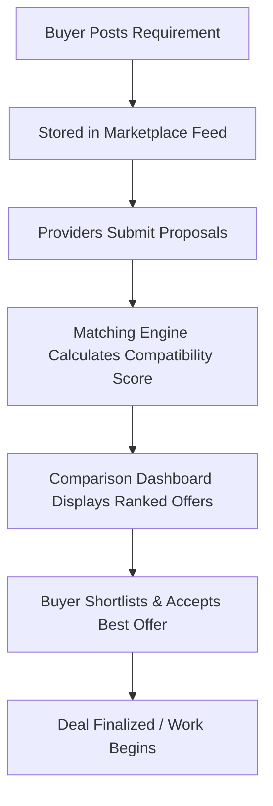

# XMARKET

A needs-first reverse marketplace where buyers post custom requirements (budget, deadline, specs) and providers submit competitive offers evaluated by an intelligent compatibility-matching engine.

[](https://opensource.org/licenses/MIT)
[](http://makeapullrequest.com)
[](https://nextjs.org)
[](https://tailwindcss.com)

> **Flip the traditional marketplace dynamic.** Instead of searching through endless listings, buyers post exact requirements, and qualified providers submit tailored offers ranked by an intelligent compatibility algorithm.

---

## 🖥️ Run the interface

```bash
npm install
npm run dev     # http://localhost:3000
npm run build   # production build
npm start       # serve the production build
```

The app ships with a seeded demo dataset (8 requirements, 16 offers, 8 providers) so every screen is populated on first load. State lives in React context and is mirrored to `localStorage`, so posting a requirement, submitting a bid, shortlisting or awarding all persist across reloads. Use the **role switch** in the header to move between the buyer and provider experiences.

---

## 🎨 UI/UX system

### Design language — monochrome, minimal

Procurement is a comparison task, so the interface is built around *legibility of differences*: prices, dates and scores line up, and nothing competes with them for attention. The palette is black, white and a five-step gray. There is exactly one accent — white — and it always means "this is the action" or "this is the strongest value".

| Token | Value | Used for |
| --- | --- | --- |
| `--color-ink-950 … 600` | `#000000` → `#262626` | canvas, panels, controls |
| `--color-accent-500` | `#ffffff` | primary buttons, active state, focus ring |
| `--color-score-high / mid / low` | `#ffffff` / `#a6a6a6` / `#6b6b6b` | the compatibility score ramp |

The score ramp is **intensity, not hue** — 96 renders as a bright white ring, 61 as a mid-gray one. Ranking stays readable at a glance and in print, and nothing depends on colour vision. Health states follow the same rule: strong offers get a heavier fill and a brighter border, weak ones recede.

**No gradients, no glows, no blur.** Panels are flat with a single hairline border; hover states shift the border and background one step. Motion is one 400 ms entrance and 500 ms bar transitions, collapsing under `prefers-reduced-motion`.

**Type.** Inter, with tabular numerals (`.num`) on every price, percentage, day count and score so columns align and cannot be misread.

### Composite primitives

`.surface` / `.surface-flat` panels, `.field` inputs, `.chip` tags, `.frame` page gutters, `.eyebrow` section labels. They live in `app/globals.css` so every screen stays visually consistent without class soup.

### Reusable components

`components/ui/primitives.tsx` — Button, Badge, StatusBadge, Card, Avatar, Rating, Progress, Segmented, EmptyState, TimeAgo, Divider
`components/ui/score.tsx` — ScoreRing, ScorePill, FactorBar, ScoreBreakdown, Sparkline
`components/ui/overlay.tsx` — Modal, Toaster

`Tone` (`neutral | outline | solid | muted | good | warn | bad`) maps semantic emphasis onto the monochrome scale, so *"accepted"* reads as a filled white pill and *"declined"* as a faint outline — the same distinction, without hue.

### Screens

| Route | Purpose | UX highlights |
| --- | --- | --- |
| `/` | Landing | Live re-ranking demo (change priorities, watch bids move), how-it-works, engine explainability, two-sided value props |
| `/market` | Requirement feed | Search across specs, category rail, budget bands, urgency + saved filters, four sort modes |
| `/market/[id]` | Requirement detail | Full brief, must-have checklist, scored offer list, offer inspector, bid composer with live score preview |
| `/compare` | Comparison index | All requirements that have offers, leading offer, price spread |
| `/compare/[id]` | **Comparison workspace** | 9-factor offer matrix with best-in-row emphasis, priority weighting sliders, hide/unhide offers, CSV export, print stylesheet, award flow with risk warnings |
| `/dashboard` | Buyer + provider command centre | Role-aware: budget exposure sparkline, decision queue, offer pipeline; provider view adds capability-fit scoring and win-rate coaching |
| `/post` | 3-step requirement wizard | Live preview card, provider-match preview, tag suggestions, milestone and validation feedback before publishing |
| `/proposals` | Offer ledger | Status filters, score per row, inline shortlist/accept, competition rank for providers |

### Interaction patterns

- **Explainability everywhere.** No score appears without its three factor bars and a plain-language reason.
- **Tunable priorities.** Weight sliders (budget / timeline / relevance) sit next to the ranking they control and re-sort instantly.
- **Progressive disclosure.** Feed → detail → comparison matrix → modal inspector.
- **Honest state.** Decline and award show a confirmation with the trade-offs and a watch-list of risks.
- **Empty, loading and error states are designed,** each carrying a next action.
- **Keyboard and a11y.** Skip link, focus-visible rings, ⌘K command palette, `aria-pressed` on toggles, `role="progressbar"` with values, labelled inputs, reduced-motion support.

### Server/client rendering invariants

React recoverable hydration errors come from markup that differs between the server render and the first client render. Two rules keep that from happening, and both are enforced by the code rather than by convention:

1. **No relative time during SSR.** `<TimeAgo>` renders a deterministic absolute date first and swaps to the relative label only after mount, behind `suppressHydrationWarning`.
2. **No fractional values in markup.** Day counts are rounded at the source (`Math.round(daysUntil(...))`), the engine scores against whole days, and every number reaching an inline style or SVG attribute goes through `round()` in `lib/format.ts`.

## 📌 Problem Statement

Traditional online marketplaces force users to browse through hundreds of irrelevant listings to find products or services matching their needs. This process is time-consuming, inefficient, and often fails when buyers have strict budgets, tight deadlines, or unique specifications.

## 💡 Solution

**XMARKET** is a reverse-bidding and procurement ecosystem designed to put the buyer's needs first:

1. **Buyers** post detailed requirements (specifications, category, max budget, deadline).
2. **Providers** submit targeted bids and proposals.
3. **The Matching Engine** scores each proposal based on compatibility (budget alignment, delivery speed, and relevance).
4. **The Comparison Dashboard** allows buyers to easily compare, shortlist, and accept the best offer.

---

## 🚀 Key Features

### 👤 For Buyers

- **Requirement Posting:** Create detailed requests with categories, budget caps, delivery deadlines, and custom tags.
- **Comparison Dashboard:** Side-by-side evaluation of all incoming bids.
- **Offer Management:** Shortlist promising offers, reject outliers, and finalize deals.
- **Smart Filtering:** Sort bids by compatibility score, lowest price, or fastest delivery.

### 🏢 For Providers / Sellers

- **Opportunity Feed:** Browse and search buyer requests relevant to your domain/skills.
- **Custom Bid Submission:** Propose pricing, estimated delivery date, and a customized pitch/milestones — with a live score preview before submitting.
- **Status Tracking:** Track whether bids are pending, shortlisted, accepted, or rejected.

### 🧠 Smart Compatibility Engine

Every offer is automatically evaluated using a multi-factor scoring algorithm (`lib/engine.ts`):

- **Budget Compatibility:** Rewards offers at or under the buyer's target price, decays gently up to the hard ceiling, and penalises over-ceiling bids hard. Suspiciously cheap bids take a credibility penalty.
- **Timeline Match:** Compares promised delivery days against the buyer's deadline, with a bonus for realistic buffer.
- **Requirement Relevance:** Weighted blend of spec-tag coverage, category fit, rating, on-time rate, response speed and verification.

$$\text{Compatibility Score} = w_1(\text{Budget}) + w_2(\text{Timeline}) + w_3(\text{Relevance})$$

Default weights are `0.35 / 0.30 / 0.35` and are tunable per requirement from the UI.

---

## 🛠️ Tech Stack

- **Frontend:** Next.js (App Router) / React 19 / TypeScript / Tailwind CSS v4 / Lucide Icons
- **State:** React context store with `localStorage` persistence (swappable for a real API)
- **Domain logic:** framework-agnostic engine + formatters in `lib/`
- **Planned backend:** Node/Express or FastAPI, PostgreSQL/MongoDB, JWT/NextAuth

### Project structure

```
app/                routes (landing, market, compare, dashboard, post, proposals, 404)
components/         feature components (feed, bid cards, compare matrix, wizards, dashboards)
components/ui/      design-system primitives, score visualisations, overlays
lib/                types, seed data, matching engine, formatters, store
```

---

## 🔄 How It Works (Workflow)



---

## 📄 License

MIT
