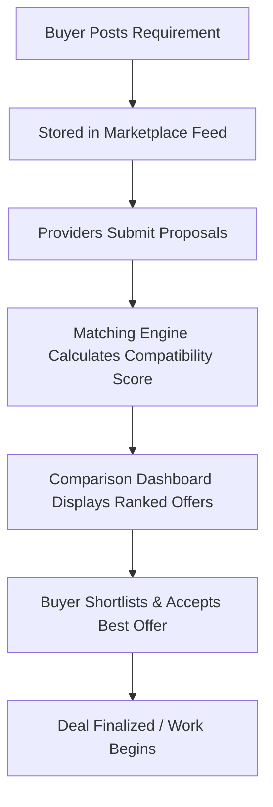

# XMARKET

A needs-first reverse marketplace where buyers post custom requirements (budget, deadline, specs) and providers submit competitive offers evaluated by an intelligent compatibility-matching engine.

[](https://opensource.org/licenses/MIT)
[](http://makeapullrequest.com)
[](https://nextjs.org)
[](https://tailwindcss.com)

> **Flip the traditional marketplace dynamic.** Instead of searching through endless listings, buyers post exact requirements, and qualified providers submit tailored offers ranked by an intelligent compatibility algorithm.

---

## 🖥️ Run the interface

```bash
npm install
npm run dev     # http://localhost:3000
npm run build   # production build
npm start       # serve the production build
```

The app ships with a seeded demo dataset (8 requirements, 16 offers, 8 providers) so every screen is populated on first load. State lives in React context and is mirrored to `localStorage`, so posting a requirement, submitting a bid, shortlisting or awarding all persist across reloads. Use the **role switch** in the header to move between the buyer and provider experiences.

---

## 🎨 UI/UX system

### Design language — “signal over noise”

Procurement is a comparison task, so the interface is built around *legibility of differences* rather than decoration. A deep ink canvas keeps long price tables comfortable, glass surfaces group related evidence, and colour is reserved for meaning.

| Token | Value | Used for |
| --- | --- | --- |
| `--color-ink-950 … 600` | `#05060b` → `#232838` | page canvas, panels, controls |
| `--color-iris-500` | `#6d5df6` | primary action, selection, focus |
| `--color-aqua-400` | `#38e0cd` | live signal, timeline factor, verified state |
| `--color-score-high / mid / low` | `#2fe08a` / `#ffc247` / `#ff6b81` | the compatibility score ramp |

Every score in the product is painted from the same three-step ramp, so a buyer learns the colour language once and can then read any screen at a glance.

**Type.** Inter, with tabular numerals (`.num`) on every price, score, percentage and count so columns of numbers align and cannot be misread.

**Motion.** A single 500 ms `rise` entrance, 700 ms numeric bar transitions, and the `pulse-soft` live dot. All motion collapses under `prefers-reduced-motion`.

### Composite primitives

`.surface` / `.surface-flat` cards, `.field` inputs, `.chip` tags, `.frame` page gutters, `.ambient` background grid + aurora, and `.gradient-text` for hero emphasis. They live in `app/globals.css` so every screen stays visually consistent without class soup.

### Reusable components

`components/ui/primitives.tsx` — Button, Badge, StatusBadge, Card, Avatar, Rating, Progress, Segmented, EmptyState, TimeAgo, Divider
`components/ui/score.tsx` — ScoreRing, ScorePill, FactorBar, ScoreBreakdown, Sparkline
`components/ui/overlay.tsx` — Modal, Toaster

### Screens

| Route | Purpose | UX highlights |
| --- | --- | --- |
| `/` | Landing | Live re-ranking demo (change priorities, watch bids move), how-it-works, engine explainability, two-sided value props |
| `/market` | Requirement feed | Search across specs, category rail, budget bands, urgency + saved filters, four sort modes |
| `/market/[id]` | Requirement detail | Full brief, must-have checklist, scored offer list, offer inspector, bid composer with live score preview |
| `/compare` | Comparison index | All requirements that have offers, leading offer, price spread |
| `/compare/[id]` | **Comparison workspace** | 9-factor offer matrix with best-in-row highlighting, priority weighting sliders, hide/unhide offers, CSV export, print stylesheet, award flow with risk warnings |
| `/dashboard` | Buyer + provider command centre | Role-aware: budget exposure sparkline, decision queue, offer pipeline; provider view adds capability-fit scoring and win-rate coaching |
| `/post` | 3-step requirement wizard | Live preview card, provider-match preview, tag suggestions, milestone/validation feedback before publishing |
| `/proposals` | Offer ledger | Status filters, score per row, inline shortlist/accept, competition rank for providers |

### Interaction patterns

- **Explainability everywhere.** No score appears without the three factor bars and a plain-language reason. The engine is auditable, not a black box.
- **Tunable priorities.** Weight sliders (budget / timeline / relevance) sit next to the ranking they control and re-sort instantly — the same bids produce a different "best" answer.
- **Progressive disclosure.** Feed → detail → comparison matrix → modal inspector. Detail is available in layers, never all at once.
- **Honest state.** Every destructive or irreversible-feeling action (decline, award) shows a confirmation with the trade-offs and a watch-list of risks.
- **Empty and loading states are designed,** not defaulted: no-offers, no-filters-match, and not-found all carry a next action.
- **Keyboard and a11y.** Skip link, focus-visible rings, ⌘K command palette, `aria-pressed` on toggles, `role="progressbar"` with values, labelled form controls, and reduced-motion support.

---

## 📌 Problem Statement

Traditional online marketplaces force users to browse through hundreds of irrelevant listings to find products or services matching their needs. This process is time-consuming, inefficient, and often fails when buyers have strict budgets, tight deadlines, or unique specifications.

## 💡 Solution

**XMARKET** is a reverse-bidding and procurement ecosystem designed to put the buyer's needs first:

1. **Buyers** post detailed requirements (specifications, category, max budget, deadline).
2. **Providers** submit targeted bids and proposals.
3. **The Matching Engine** scores each proposal based on compatibility (budget alignment, delivery speed, and relevance).
4. **The Comparison Dashboard** allows buyers to easily compare, shortlist, and accept the best offer.

---

## 🚀 Key Features

### 👤 For Buyers

- **Requirement Posting:** Create detailed requests with categories, budget caps, delivery deadlines, and custom tags.
- **Comparison Dashboard:** Side-by-side evaluation of all incoming bids.
- **Offer Management:** Shortlist promising offers, reject outliers, and finalize deals.
- **Smart Filtering:** Sort bids by compatibility score, lowest price, or fastest delivery.

### 🏢 For Providers / Sellers

- **Opportunity Feed:** Browse and search buyer requests relevant to your domain/skills.
- **Custom Bid Submission:** Propose pricing, estimated delivery date, and a customized pitch/milestones — with a live score preview before submitting.
- **Status Tracking:** Track whether bids are pending, shortlisted, accepted, or rejected.

### 🧠 Smart Compatibility Engine

Every offer is automatically evaluated using a multi-factor scoring algorithm (`lib/engine.ts`):

- **Budget Compatibility:** Rewards offers at or under the buyer's target price, decays gently up to the hard ceiling, and penalises over-ceiling bids hard. Suspiciously cheap bids take a credibility penalty.
- **Timeline Match:** Compares promised delivery days against the buyer's deadline, with a bonus for realistic buffer.
- **Requirement Relevance:** Weighted blend of spec-tag coverage, category fit, rating, on-time rate, response speed and verification.

$$\text{Compatibility Score} = w_1(\text{Budget}) + w_2(\text{Timeline}) + w_3(\text{Relevance})$$

Default weights are `0.35 / 0.30 / 0.35` and are tunable per requirement from the UI.

---

## 🛠️ Tech Stack

- **Frontend:** Next.js (App Router) / React 19 / TypeScript / Tailwind CSS v4 / Lucide Icons
- **State:** React context store with `localStorage` persistence (swappable for a real API)
- **Domain logic:** framework-agnostic engine + formatters in `lib/`
- **Planned backend:** Node/Express or FastAPI, PostgreSQL/MongoDB, JWT/NextAuth

### Project structure

```
app/                routes (landing, market, compare, dashboard, post, proposals, 404)
components/         feature components (feed, bid cards, compare matrix, wizards, dashboards)
components/ui/      design-system primitives, score visualisations, overlays
lib/                types, seed data, matching engine, formatters, store
```

---

## 🔄 How It Works (Workflow)



---

## 📄 License

MIT
